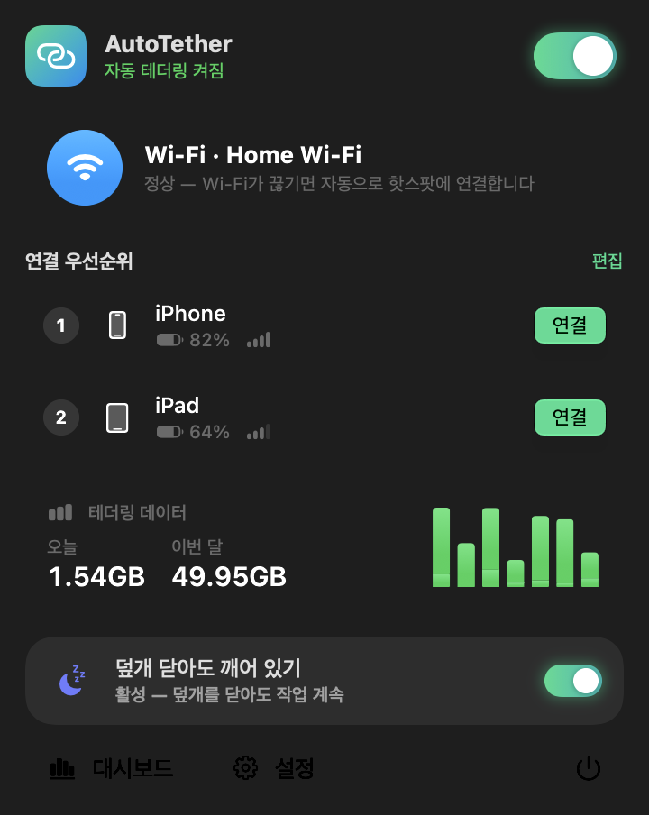
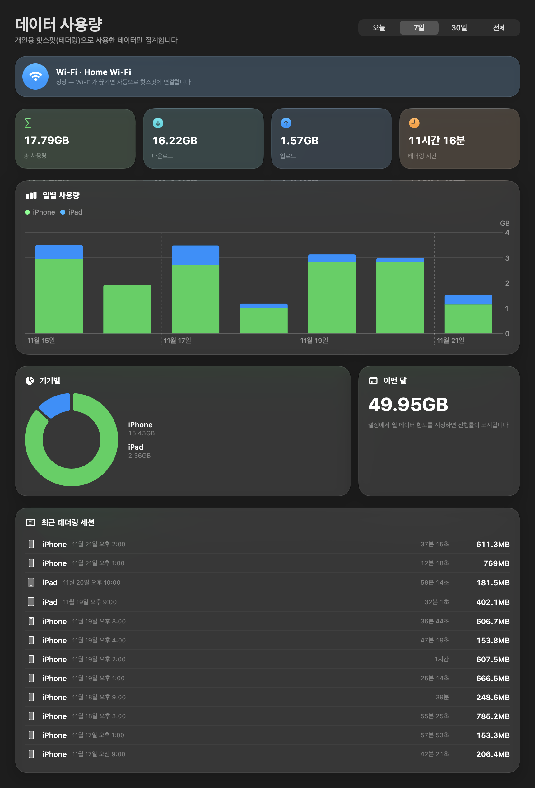

# AutoTether

[English](README.md) · **한국어**

Wi-Fi가 끊기거나 연결은 됐는데 인터넷이 안 되면, 정해 둔 순서대로 iPhone·iPad 개인용 핫스팟에 자동으로 연결해 주는 macOS 메뉴바 앱입니다. 저장된 Wi-Fi가 다시 잡히면 그쪽으로 돌아옵니다.

<p align="center">
  
  &nbsp;
  
</p>

> 개인 프로젝트로 만들어 **소스 코드로 공유**합니다. 저도 아래 오픈소스들을 참고하며 만들었듯이, 읽고 배우고 고쳐 쓰는 용도입니다. 빌드된 앱은 배포하지 않으니 본인의 Apple 개발자 팀으로 직접 빌드하세요.

## 기능

| | |
|---|---|
| **우선순위 자동 전환** | 정해 둔 순서(예: iPhone → iPad)대로 연결을 시도합니다. Wi-Fi가 약 10초 끊기거나, Wi-Fi에 붙어 있어도 30초 동안 인터넷이 안 되면 시작해요. |
| **핫스팟 원격 켜기** | Instant Hotspot으로 기기의 핫스팟을 블루투스로 켜고 접속 정보를 받아요. 비밀번호를 입력할 필요가 없어요. |
| **Wi-Fi 자동 복귀** | 핫스팟을 쓰는 동안 2분마다 저장된 Wi-Fi를 찾아서, 잡히면 돌아가 데이터를 아껴요. |
| **덮개 닫아도 깨어 있기** | 덮개를 닫아도 Mac이 잠들지 않게 해요. 테더링 중에만, 또는 배터리가 일정 이상일 때만 켜지게 할 수 있어요. 앱에서 켤 때 **Touch ID나 관리자 암호**로 인증하고, 끄면 그 동의가 철회돼요. |
| **사용량 대시보드** | 오늘·7일·30일·전체 사용량, 일별·시간대별 차트, 기기별 비율, 월 한도 게이지, 세션 기록을 보여 줘요. |
| **메뉴바 중심** | Liquid Glass UI(macOS 26), 마스터 스위치, 로그인 시 자동 실행, 알림, 활동 기록을 지원해요. |

처음 설치하면 주변에서 발견한 내 기기(같은 Apple ID)로 우선순위 목록이 자동으로 채워져요.

## 동작 방식 (실기기로 확인한 사실)

- **Instant Hotspot은 SSID를 숨김으로 송출해서** 일반 스캔에는 잡히지 않아요. 이름을 지정해서 검색(`scanForNetworks(withName:includeHidden:)`)한 뒤 `associate(to:password:)`로 연결해요.
- **최신 iOS 핫스팟은 IPv6 전용 + CLAT(`192.0.0.2`)이라** 예전처럼 `172.20.10.x` 주소로는 판별할 수 없어요. 대신 `NWPathMonitor`의 *expensive* 경로 신호로 테더링을 판별해요.
- **iOS는 핫스팟 BSSID를 세션마다 바꿔요.** BSSID로 기기를 고정하면 전환이 깨지기 때문에, 보안 방식(WPA3)으로 믿을 수 있는지 판단해요.
- **CoreWLAN은 WPA2 전용 AP에서도 `.wpa3Transition`을 지원한다고 알려 줘요.** 그래서 WPA3(SAE) 지원 여부는 `.wpa3Personal`로만 판단해요.
- **핫스팟에서 일반 Wi-Fi로 돌아갈 때 `networksetup` 첫 시도는 자주 실패해요.** 명령 결과가 아니라 실제 네트워크 상태로 판단하고, 최대 3번 다시 시도해요.
- 사용량은 64비트 인터페이스 카운터(`sysctl NET_RT_IFLIST2`)로 재요. 테더링 중에는 2초, 평소에는 10초마다 읽고, SQLite(GRDB)에 시간 단위로 쌓아요.

## 보안 설계

네트워크에 자동으로 접속하고 root 권한이 필요한 전원 설정을 다루는 앱이라, AI 코드 리뷰어 3종(Codex, Antigravity, 로컬 Qwen)으로 여러 차례 교차 검토하고 실기기로 시험했어요.

| 위협 | 방어 |
|---|---|
| 같은 이름의 가짜 핫스팟(Evil Twin) | SSID가 정확히 일치해야 하고, WPA2/3 개인용만 허용해요(개방형·WEP·OWE·엔터프라이즈를 함께 광고하면 거부). 비밀번호는 반드시 기기에서 받은 것만 써요. |
| WPA2 가짜 AP로 비밀번호 탈취 | 자동 연결은 **WPA3(SAE)만** 허용하고, 연결한 뒤 실제로 협상된 보안 방식까지 확인해요. WPA2는 기기별로 직접 허용해야 해요. |
| 복귀할 때 저장된 개방형 Wi-Fi의 가짜 AP | 개방형·OWE·WEP으로는 돌아가지 않아요. 같은 이름의 약한 AP가 하나라도 보이면 그 이름은 제외해요. macOS 자동 연결에 맡기지 않고, 연결한 뒤 보안을 다시 확인해요. |
| 권한 오남용 | root 헬퍼는 `SMAppService`로 등록하고 시스템 설정에서 승인받아요. 헬퍼는 같은 팀으로 서명됐고 **앱 식별자까지 일치하는** 클라이언트만 받고, 앱도 헬퍼의 서명을 확인해요. 헬퍼가 할 수 있는 일은 상태 조회, `pmset disablesleep` 켜기·끄기, 동의 기록·철회, 예전 버전의 sudoers 파일 삭제, 업그레이드 전 복구 후 종료뿐이에요. |
| 사용자 모르게 켜기 | 앱에서 옵션을 켜면 macOS 인증 창(Touch ID 또는 관리자 암호)이 떠요. **헬퍼가 그 인증을 직접 검증**하고, 검증에 쓴 권한은 바로 폐기해요. 시스템 인증 DB의 규칙이 기대한 정책(관리자 인증·비공유·짧은 유효시간)일 때만 받아들여요. 옵션을 끄면 동의가 철회되고, 철회가 확인되기 전에는 다시 켜지지 않아요. |
| 앱이 죽어서 잠자기 방지가 남는 경우 | 앱의 XPC 연결이 끊기면 헬퍼가 즉시 원래대로 돌려놓아요(시험에서 `kill -9` 후 약 0.5초). 켜기 전에 소유 표시를 먼저 기록하므로, 헬퍼 자신이 멈췄더라도 다음 시작(부팅 시 실행) 때 복구해요. |
| 코드 주입·디버깅 | Hardened Runtime을 켜고, Release 빌드에서는 `get-task-allow`를 제거해요. 진단 코드는 Debug 빌드에만 들어가요. |
| 비밀 정보 노출 | 핫스팟 비밀번호는 프로세스 인자·로그·파일 어디에도 남지 않아요. 로그와 DB는 `0600` 권한이고, 로그에 들어가는 문자열은 정리해서 기록해요. |

알려진 한계가 있어요. 인터넷 확인이 특정 인터페이스에 묶여 있지 않아서 VPN의 영향을 받을 수 있어요(기본 경로를 먼저 확인해 완화). 또 비공개 API(`Sharing.framework`)를 써서 Mac App Store에는 올릴 수 없어요.

## 요구 사항

- macOS 26 이상(Liquid Glass UI), macOS 26 SDK가 포함된 Xcode 26 이상
- Apple 개발자 팀. 로컬 빌드는 무료 개인 팀으로도 돼요. 권한 헬퍼가 코드 서명을 확인하기 때문에, 서명 없이 빌드하면 잠자기 방지가 동작하지 않아요.
- 같은 Apple ID로 로그인한 iPhone/iPad, 블루투스 켜짐
- 위치 권한(macOS에서 Wi-Fi 이름을 읽으려면 필요해요)

## 빌드

```sh
brew install xcodegen
git clone <이 저장소> && cd AutoTether

# 본인 서명 팀 (이 파일은 git에 올라가지 않음)
echo 'DEVELOPMENT_TEAM = 본인팀ID' > Config/Local.xcconfig

xcodegen generate
xcodebuild -project AutoTether.xcodeproj -scheme AutoTether -configuration Release -derivedDataPath build build
cp -R build/Build/Products/Release/AutoTether.app /Applications/
open /Applications/AutoTether.app
```

팀 ID는 Xcode › Settings › Accounts에서 보거나, "Apple Development" 인증서의 `OU` 값을 확인하면 돼요. 번들 ID 기본값은 `com.imgold.AutoTether*`예요. 그대로 써도 되고, `project.yml`, `Shared/HelperProtocol.swift`, `Helper/*.plist`에서 바꿀 수 있어요.

**"덮개를 닫아도 잠자기하지 않기"**를 처음 켤 때는 **시스템 설정 › 일반 › 로그인 항목 및 확장 프로그램**에서 AutoTether 헬퍼를 허용해야 해요. 그다음부터는 옵션을 켤 때 Touch ID나 암호로 승인하면 돼요.

## 테스트

```sh
xcodebuild -project AutoTether.xcodeproj -scheme AutoTether -derivedDataPath build test
```

단위 테스트는 판단 로직을 확인해요. 핫스팟 후보 선택과 순위, WPA2/WPA3 판정(iOS 26에서 측정한 보안 방식 조합 사용), Wi-Fi 복귀 후보 필터, 테더링 판별, 사용량 계산, SQLite 저장소가 대상이에요. 테스트를 믿고 쓰기 전에, 현장에서 고친 버그(예: `.wpa3Transition`을 믿는 코드)를 일부러 다시 넣어 보고 테스트가 실패하는지 확인해 보세요.

Debug 빌드에는 실기기 점검용 진단 CLI도 들어 있어요. 별도 DB를 쓰고 전원 설정은 건드리지 않아요.

```sh
APP=build/Build/Products/Debug/AutoTether.app/Contents/MacOS/AutoTether
$APP --status                                   # 네트워크·기기·권한 상태
$APP --test-connect "내 iPhone" --and-return    # 수동 연결 → 사용량 측정 → Wi-Fi 복귀
$APP --test-failover                            # 자동 전환(WPA3 필수) → 복귀
$APP --test-cancel                              # 스위치를 끄면 진행 중인 전환이 멈추는지
$APP --filter-test "*"                          # 연결하지 않고 주변 AP로 가짜 AP 필터 판정
$APP --snapshot ./out --demo-data               # 익명 데모 데이터로 화면을 PNG로 저장
DEVICE="내 iPhone" HOME_SSID="집_5G 집_2.4G" scripts/verify_security_cycle.sh
```

CLI를 쓰기 전에 메뉴바 앱을 먼저 종료하세요 (`pkill -x AutoTether`).

## 구조

```
AutoTether/App      앱 진입점, 모델, 진단 CLI·스냅샷(Debug 전용)
AutoTether/Core     전환 엔진, Wi-Fi 제어, 판단 로직(Policy), 사용량 저장, 잠자기 방지, XPC 클라이언트
AutoTether/Bridge   Objective-C 브리지: Instant Hotspot(비공개 API), 인터페이스 카운터
AutoTether/UI       메뉴바 패널과 메인 창 (SwiftUI, Liquid Glass)
Helper/             권한 헬퍼(root LaunchDaemon): pmset만, 서명 검증 XPC, 인증 검증
Shared/             앱·헬퍼 공용 XPC 프로토콜, 서명 정보
Tests/              단위 테스트 (앱을 띄우지 않으며 네트워크·전원 설정을 건드리지 않음)
```

## 참고한 오픈소스

아래 프로젝트들 덕분에 만들 수 있었어요. 감사합니다.

- [sindresorhus/Defaults](https://github.com/sindresorhus/Defaults): 설정 저장
- [sindresorhus/LaunchAtLogin-Modern](https://github.com/sindresorhus/LaunchAtLogin-Modern): 로그인 시 실행
- [groue/GRDB.swift](https://github.com/groue/GRDB.swift): 사용량 DB
- [yonaskolb/XcodeGen](https://github.com/yonaskolb/XcodeGen): 프로젝트 생성
- [samihalawa/mac-auto-hotspot](https://github.com/samihalawa/mac-auto-hotspot): Instant Hotspot 비공개 API 사용법 참고
- [exelban/stats](https://github.com/exelban/stats): 64비트 인터페이스 카운터 읽는 방식 참고
- [newmarcel/KeepingYouAwake](https://github.com/newmarcel/KeepingYouAwake): 잠자기 방지 방식 참고

## 주의

개인 프로젝트이고 있는 그대로 제공돼요. 비공개 macOS API를 써서 OS 업데이트에 따라 동작이 바뀔 수 있어요. 덮개를 닫은 채 가방에 넣으면 과열될 수 있으니 "배터리 보호"와 "테더링 중일 때만 적용" 옵션을 함께 쓰세요.

## 라이선스

[MIT](LICENSE)
