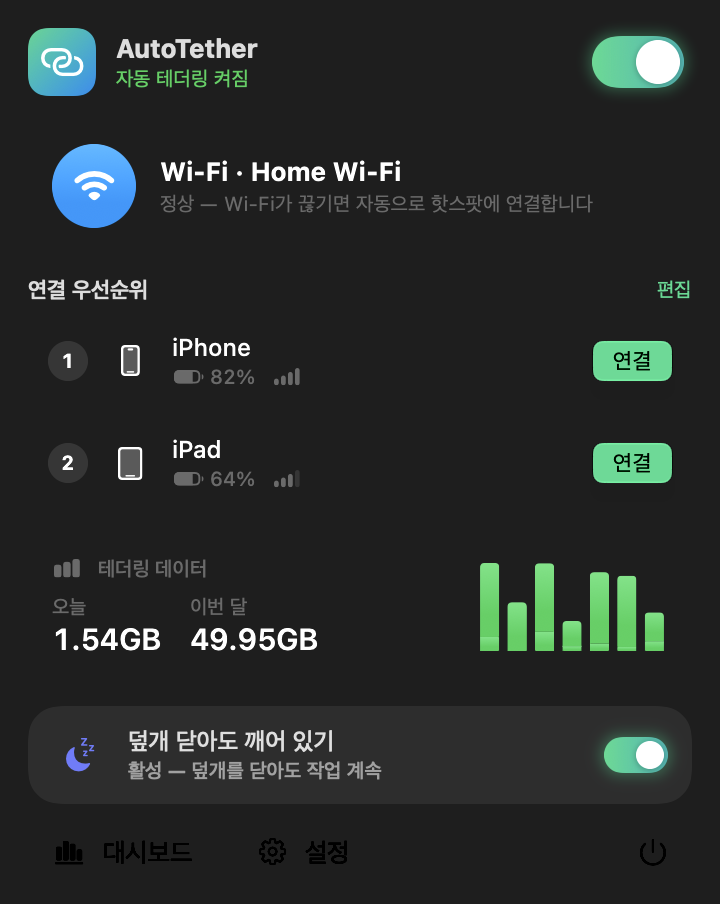
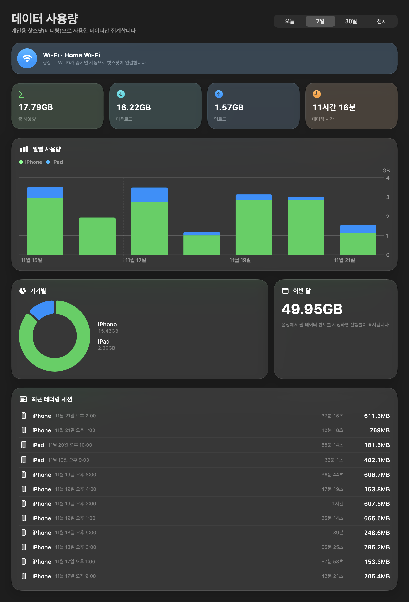

# AutoTether

**English** · [한국어](README.ko.md)

A macOS menu bar app that keeps you online. When Wi-Fi drops (or stays connected but has no internet), it switches to your iPhone or iPad Personal Hotspot in the order you choose. When a saved Wi-Fi network comes back, it returns to it.

<p align="center">
  
  &nbsp;
  
</p>

> Built as a personal project and shared as **source code** for others to read, learn from and adapt, the same way it borrowed ideas from the open-source projects listed below. No prebuilt binaries are distributed. Build it yourself with your own Apple developer team.

## Features

| | |
|---|---|
| **Priority failover** | Tries your devices in order (e.g. iPhone → iPad). Triggers after about 10 s without Wi-Fi, or 30 s on Wi-Fi with no internet. |
| **Remote hotspot wake-up** | Uses Instant Hotspot to turn on the device's hotspot over Bluetooth and fetch its credentials. You don't type a password. |
| **Return to Wi-Fi** | While tethered, checks every 2 minutes for a saved Wi-Fi network and switches back to save mobile data. |
| **Lid-closed awake mode** | Keeps the Mac awake with the lid closed, optionally only while tethered or above a battery floor. When you switch it on in the app, macOS asks for **Touch ID or your admin password**. Switching it off revokes that consent. |
| **Usage dashboard** | Today / 7 / 30 days / all time, daily or hourly charts, per-device breakdown, monthly cap gauge, session history. |
| **Menu bar first** | Liquid Glass UI (macOS 26), master on/off switch, launch at login, notifications, activity log. |

New installs fill the priority list automatically with the devices found nearby (same Apple ID).

## How it works (verified on real hardware)

- **Instant Hotspot SSIDs are hidden**, so a normal CoreWLAN scan never sees them. AutoTether does a directed scan (`scanForNetworks(withName:includeHidden:)`) and then calls `associate(to:password:)`.
- **Modern iOS hotspots are IPv6-only + CLAT** (`192.0.0.2`), so the classic `172.20.10.x` check fails. Tethering is detected from the `NWPathMonitor` *expensive* path flag instead.
- **iOS rotates the hotspot BSSID between sessions**, so BSSID pinning breaks failover. Trust is based on security capability (WPA3) instead.
- **CoreWLAN reports `.wpa3Transition` as supported even on WPA2-only APs.** Only `.wpa3Personal` is a reliable signal of SAE support.
- **`networksetup -setairportnetwork` often fails on the first hotspot → Wi-Fi attempt.** Success is judged by real network state, with up to 3 retries.
- Usage comes from 64-bit interface counters (`sysctl NET_RT_IFLIST2`). They're sampled every 2 s while tethered and every 10 s otherwise, and stored in hourly buckets in SQLite (GRDB).

## Security design

The app joins Wi-Fi networks automatically and holds a root-level power setting, so it was reviewed in several rounds by three independent AI code reviewers (Codex, Antigravity, local Qwen) and tested against real devices.

| Threat | Mitigation |
|---|---|
| Evil-twin hotspot with the same name | Exact SSID, WPA2/3-Personal only (rejects anything that also advertises open/WEP/OWE/enterprise), password must come from the device |
| WPA2 rogue AP capturing the handshake | Auto-join **requires WPA3 (SAE)** and verifies the negotiated security after joining. WPA2 is an explicit per-device opt-in. |
| Rogue open network when returning to Wi-Fi | Open/OWE/WEP never accepted. An SSID is dropped if any weak AP shares its name. Never hands control to macOS auto-join. Security re-checked after joining. |
| Privilege misuse | The root helper is installed with `SMAppService` and approved in System Settings. It accepts only XPC clients signed by the same team **and** with the app's identifier, and the app checks the helper's signature too. Its only verbs: read state, turn `pmset disablesleep` on/off, record/revoke consent, remove the legacy sudoers file from older versions, and restore-then-exit before an upgrade. |
| Enabling without the user's consent | Switching the option on in the app shows a macOS Authorization Services prompt (Touch ID or admin password). The **helper verifies** that authorization itself and destroys it after use. It only accepts it if the authorization rule in the system database still has the expected admin/non-shared/short-timeout policy. Switching off revokes consent, and the app won't re-enable until the helper confirms the revocation. |
| Crash leaves the Mac unable to sleep | The helper restores the setting as soon as the app's XPC connection drops (about 0.5 s after `kill -9` in our tests). It writes an ownership marker *before* enabling, so if the helper itself stops, it restores at its next start (it runs at boot). |
| Code injection / debugging | Hardened Runtime. Release builds strip `get-task-allow`. Diagnostic code is compiled into Debug builds only. |
| Secrets on disk | Hotspot passwords never appear in process arguments, logs or files. Logs and DB are `0600`. Log input is sanitized. |

Known limitations: the internet probe isn't bound to a specific interface. A VPN can affect it, which is partly mitigated by checking the primary route first. Private APIs (`Sharing.framework`) mean this can't ship on the Mac App Store.

## Requirements

- macOS 26 or later (Liquid Glass UI), Xcode 26+ with the macOS 26 SDK
- An Apple Developer team. A free personal team works for local builds. It's needed because the privileged helper verifies code signatures, so unsigned builds won't enable lid-closed mode.
- iPhone/iPad signed in to the same Apple ID, with Bluetooth on
- Location permission (macOS requires it to read Wi-Fi network names)

## Build

```sh
brew install xcodegen
git clone <this repo> && cd AutoTether

# Your signing team (this file is git-ignored)
echo 'DEVELOPMENT_TEAM = YOURTEAMID' > Config/Local.xcconfig

xcodegen generate
xcodebuild -project AutoTether.xcodeproj -scheme AutoTether -configuration Release -derivedDataPath build build
cp -R build/Build/Products/Release/AutoTether.app /Applications/
open /Applications/AutoTether.app
```

To find your team ID, open Xcode › Settings › Accounts, or look up the `OU` field of your "Apple Development" certificate. Bundle identifiers default to `com.imgold.AutoTether*`. You can keep them or change them in `project.yml`, `Shared/HelperProtocol.swift` and `Helper/*.plist`.

The first time you turn on **"덮개를 닫아도 잠자기하지 않기"** (stay awake with lid closed), allow the AutoTether helper in **System Settings › General › Login Items & Extensions**. After that, approve with Touch ID or your password whenever you switch the option on.

## Tests

```sh
xcodebuild -project AutoTether.xcodeproj -scheme AutoTether -derivedDataPath build test
```

The unit tests cover the decision logic: hotspot candidate selection and ranking, WPA2/WPA3 classification (using security sets measured on iOS 26), return-to-Wi-Fi filtering, tether detection, usage math, and the SQLite store. Before relying on a test, try a mutation check: reintroduce a bug that was fixed in the field (such as trusting `.wpa3Transition`) and confirm the test fails.

Debug builds also include a diagnostic CLI for real-device checks. It uses a separate DB and never touches power settings:

```sh
APP=build/Build/Products/Debug/AutoTether.app/Contents/MacOS/AutoTether
$APP --status                                   # network, devices, permissions
$APP --test-connect "My iPhone" --and-return    # manual join → measure usage → return to Wi-Fi
$APP --test-failover                            # automatic path (WPA3 required) → return
$APP --test-cancel                              # turning the switch off aborts an in-flight failover
$APP --filter-test "*"                          # run the evil-twin filter against nearby APs without joining
$APP --snapshot ./out --demo-data               # render the UI to PNG with anonymized demo data
DEVICE="My iPhone" HOME_SSID="Home_5G Home_2.4G" scripts/verify_security_cycle.sh
```

Quit the menu bar app before using the CLI (`pkill -x AutoTether`).

## Project layout

```
AutoTether/App      app entry, model, debug CLI & snapshot renderer (Debug only)
AutoTether/Core     engine, Wi-Fi control, policy (pure logic), usage store, sleep guard, XPC client
AutoTether/Bridge   Objective-C bridges: Instant Hotspot (private API), interface counters
AutoTether/UI       menu bar panel and main window (SwiftUI, Liquid Glass)
Helper/             privileged LaunchDaemon (root): pmset only, signature-checked XPC, auth verification
Shared/             XPC protocol and code-signing identity shared by app and helper
Tests/              unit tests (no app host; nothing touches your network or power settings)
```

## Acknowledgements

These open-source projects shaped how AutoTether works. Thank you.

- [sindresorhus/Defaults](https://github.com/sindresorhus/Defaults): typed settings
- [sindresorhus/LaunchAtLogin-Modern](https://github.com/sindresorhus/LaunchAtLogin-Modern): launch at login
- [groue/GRDB.swift](https://github.com/groue/GRDB.swift): SQLite usage store
- [yonaskolb/XcodeGen](https://github.com/yonaskolb/XcodeGen): project generation
- [samihalawa/mac-auto-hotspot](https://github.com/samihalawa/mac-auto-hotspot): reference for the Instant Hotspot private API
- [exelban/stats](https://github.com/exelban/stats): reference for reading 64-bit interface counters
- [newmarcel/KeepingYouAwake](https://github.com/newmarcel/KeepingYouAwake): reference for keeping the Mac awake

## Disclaimer

Personal project, provided as is. It uses private macOS APIs that may change in any OS update. Keeping a closed laptop awake in a bag can cause overheating, so use the battery floor and "only while tethered" options.

## License

[MIT](LICENSE)
